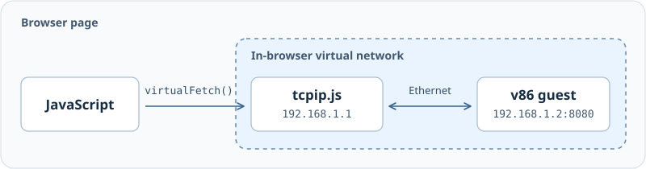

# Connect browser JavaScript to a v86 guest with tcpip.js

Use tcpip.js when you need to communicate with a service inside the guest.
In this example, JavaScript requests a file from a web server in the guest.
The request and response stay in the same browser page. No relay server or
internet connection is needed for that exchange.



## Attach the virtual network

Start with a working [v86 embed](../examples/basic.html) and a Linux guest
with a driver for its emulated NIC. In a project that uses a JavaScript
bundler, install the networking packages:

```sh
npm install tcpip@0.4.1 @tcpip/v86@0.2.4 @tcpip/http@0.2.2 @tcpip/transport@0.1.0
```

If you use Vite, add `tcpip` and `@tcpip/http` to
`optimizeDeps.exclude` so their WebAssembly files can load during development.

Remove any relay URL from your v86 configuration. Set `autostart: false` so
you can attach the virtual network before starting the guest. Keep the NIC type
that your guest supports. Add this to the module that creates the emulator:

```js
import { createStack } from "tcpip";
import { createV86NetworkStream } from "@tcpip/v86";
import { createHttp } from "@tcpip/http";
import { connectStreams } from "@tcpip/transport";

const stack = await createStack();
const tap = await stack.interfaces.createTap({ ip: "192.168.1.1/24" });
const nic = createV86NetworkStream(emulator);

connectStreams(tap, nic);

const { fetch: virtualFetch } = await createHttp(stack.tcp);
await emulator.run();
```

`connectStreams()` forwards Ethernet frames between the stack and the guest.

## Start an HTTP service in the guest

If you build the guest image for your app, you can configure the network and
start your service at boot. To try it by hand, use a Linux guest with Python 3
installed. The basic embed example’s `linux.iso` does not include Python.

Run these commands as root in the guest. Use `ip link` to check the interface
name and replace `eth0` if yours differs.

```sh
ip link set eth0 up
ip addr add 192.168.1.2/24 dev eth0

mkdir -p /tmp/v86-http-demo
printf 'Hello from v86\n' > /tmp/v86-http-demo/index.html
cd /tmp/v86-http-demo
python3 -m http.server 8080 --bind 192.168.1.2
```

The virtual link uses a static address, so it needs no DHCP server, DNS
resolver, or default gateway.

## Read the response from JavaScript

Once the guest prints that the HTTP server is listening, run this from your
application, for example in a button handler:

```js
const response = await virtualFetch("http://192.168.1.2:8080/");
if (!response.ok) {
    throw new Error(`Guest returned HTTP ${response.status}`);
}
console.log(await response.text()); // Hello from v86
```

`virtualFetch` sends plain HTTP to services reachable on the virtual network.
You can also pass it to an SDK that accepts a custom `fetch` implementation.
If the request fails, check the guest interface name, its IP address, and the
address and port the server listens on.

For other TCP protocols, call
[`stack.tcp.connect()`](https://github.com/chipmk/tcpip.js#stacktcpconnect)
with the guest address and port. For multiple guests, see
[tcpip.js bridge interfaces](https://github.com/chipmk/tcpip.js#bridge-interface).
